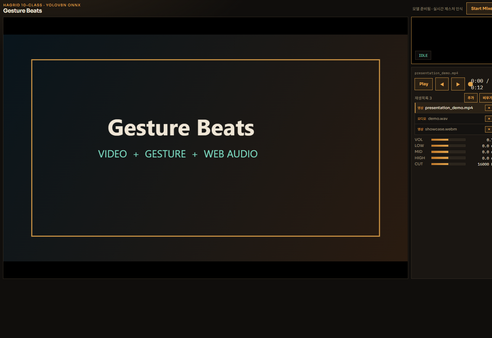

# Gesture Beats · 제스처 비트

웹캠 속 손 제스처로 오디오 플레이어와 믹서를 제어하는 웹 데모

**Python · YOLOv8 · ONNX Runtime Web · Web Audio API · Vanilla JavaScript**

---

## 프로젝트 소개

Gesture Beats는 웹캠으로 손 제스처를 인식해 재생, 볼륨, 시크, EQ, DJ 필터를 손으로 조작하는 웹 오디오 믹서입니다.

HaGRID 데이터셋에서 10개 제스처 클래스를 추려 **YOLOv8n을 직접 파인튜닝**했고, 학습한 모델을 ONNX로 변환해 **브라우저 안에서 직접 추론**합니다. 서버는 정적 파일만 제공하므로 영상이 외부로 전송되지 않습니다.

---

## 기술 스택

| 구분 | 기술 |
|---|---|
| Model | YOLOv8n (Ultralytics), PyTorch |
| Inference | ONNX Runtime Web (WASM), 입력 320×320 |
| Audio | Web Audio API (GainNode, BiquadFilter) |
| Frontend | HTML, CSS, Vanilla JavaScript |
| Server | Python 표준 라이브러리 (`http.server`) |
| Dataset | HaGRID (10 클래스 서브셋) |

---

## 주요 기능

- **손 제스처 인식**: 웹캠 프레임을 YOLO로 추론해 손의 클래스와 위치를 얻습니다.
- **상태머신 기반 제어**: 이벤트형(재생 토글, 다음 곡)과 홀드형(볼륨, 필터, EQ) 제스처를 구분해 기능 충돌을 막습니다.
- **오디오 믹서**: 마스터 볼륨, 3밴드 EQ, DJ 로우패스 필터, 시크, 비주얼라이저.
- **파일 재생**: 기본 `demo.wav`를 쓰거나 오디오·영상 파일을 직접 올릴 수 있습니다.
- **키보드 대체 조작**: 웹캠이 없어도 키보드로 모든 기능을 테스트할 수 있습니다.

### 제스처 매핑

| 제스처 | 동작 |
|---|---|
| `fist` → `palm` | 재생 / 일시정지 (전환 순간 1회) |
| `ok` + 높이 / 좌우 | 볼륨 / 시크 |
| `like` + 좌우 | DJ 로우패스 필터 |
| `dislike` | 다음 파일 |
| `one` + 높이 | EQ Low |
| `peace` + 높이 | EQ Mid |
| `three` + 높이 | EQ High |

학습 클래스는 `fist, palm, peace, one, two_up, three, ok, like, dislike, call` 10개이며, confidence 0.55 미만의 검출은 무시합니다.

---

## 모델 성능

HaGRID 서브셋 검증 2,000장(클래스당 200장) 기준입니다.

| Precision | Recall | mAP50 | mAP50-95 |
|---|---|---|---|
| 0.992 | 0.990 | 0.994 | 0.880 |

학습 중 라벨 좌표계 오류로 mAP50이 2%대에 머물렀던 문제와 해결 과정은 [트러블슈팅.md](트러블슈팅.md)에 정리했습니다.

---

## 서비스 흐름

```text
웹캠 프레임
    ↓
320×320 letterbox 전처리
    ↓
best.onnx 추론 (ONNX Runtime Web)
    ↓
제스처 상태머신 (이벤트 / 홀드 판별)
    ↓
Web Audio 파라미터 적용 (setTargetAtTime 스무딩)
    ↓
오디오 출력 · 화면 갱신
```

---

## 프로젝트 구조

```text
GestureBeats/
├── demo.py                 # 데모 서버 + 웹 UI (단일 파일)
├── GestureBeats.ipynb      # 데이터 준비 · 학습 · ONNX export
├── requirements.txt        # 학습 환경 의존성
├── 기획서.md
├── 트러블슈팅.md
├── assets/
│   └── audio/demo.wav      # 샘플 음원
└── models/
    ├── best.onnx           # 브라우저 추론용 모델
    ├── best.pt             # PyTorch 가중치
    ├── labels.json         # 클래스 이름 · 입력 크기 · conf 기준값
    └── demo_ui.png
```

---

## 주요 화면



---

## 로컬 실행 방법

데모 실행에는 Python 3.10 이상만 있으면 됩니다. 별도 패키지 설치는 필요 없습니다.

### 1. 서버 실행

```bash
python demo.py
```

옵션:

```bash
python demo.py --port 9000 --no-browser
```

### 2. 브라우저 접속

```text
http://127.0.0.1:8080
```

웹캠은 `localhost` 또는 https에서만 열립니다. 시작 버튼을 누르고 카메라 권한을 허용하세요. ONNX Runtime Web은 CDN에서 불러오므로 인터넷 연결이 필요합니다.

---

## 모델 재학습

`GestureBeats.ipynb`로 데이터 서브셋 생성, YOLOv8n 학습, ONNX export를 진행합니다. 데이터셋은 용량 문제로 저장소에 포함하지 않았으므로 [HaGRID](https://github.com/hukenovs/hagrid)를 별도로 받아야 합니다.

```bash
pip install -r requirements.txt
# GPU 사용 시 CUDA 휠로 설치
pip install torch torchvision --index-url https://download.pytorch.org/whl/cu126
```

---

## 향후 개선 방향

- **양손 제스처**: 양손 핀치 시크 등 두 손 동시 인식
- **웹캠 커스텀 데이터 추가**: 실제 사용 환경의 조명·배경에 맞춘 재학습
- **Q 조절 · 하이패스 전환**: 필터 제어 범위 확장
